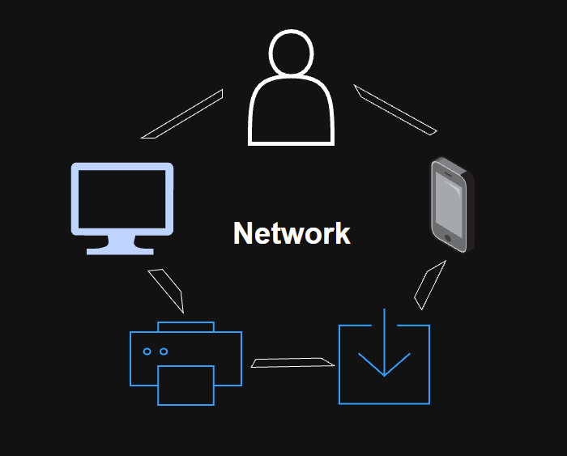
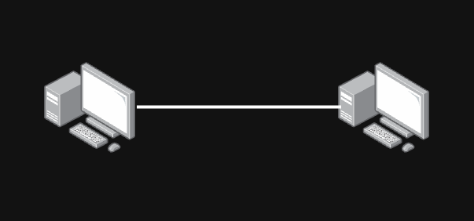
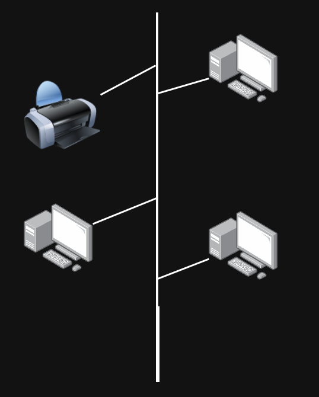
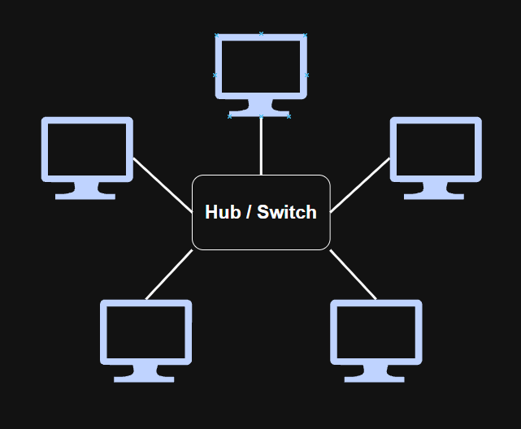
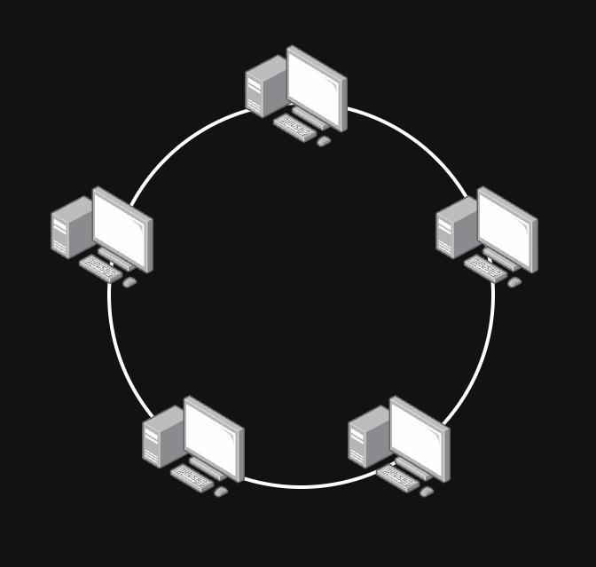
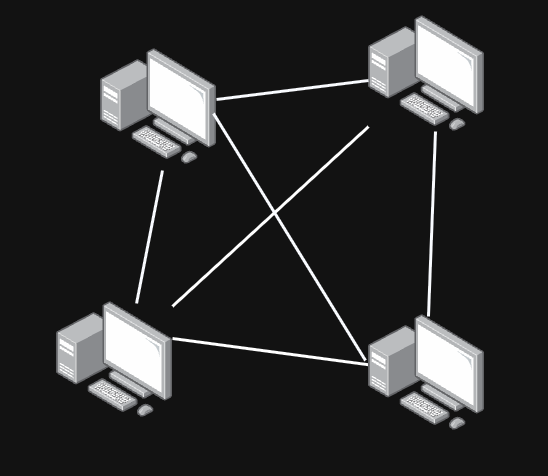
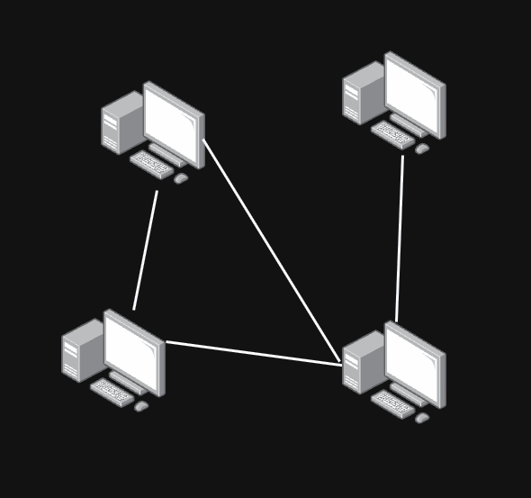
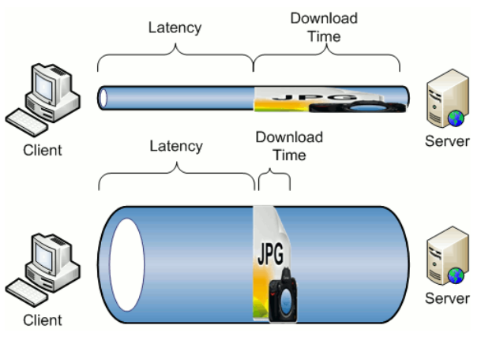

# Network

## 1. What Is a Network?

> **Network**: A collection of interconnected devices that communicate and share information or resources.

Many services that we use in daily life rely on computer networks.

Examples:
- Online games
- Email
- Video conferencing

### Uses of Networks

#### 1. Sharing Peripheral Devices

> **Peripheral Device**: A hardware device connected to or used with a computer system.

Examples include printers, scanners, keyboards, and storage devices.

A network can allow multiple computers to share a device. For example, several computers in an office can use the same network printer.

#### 2. Sharing Files

Networks allow users and devices to exchange files and information.

For example, computers connected to the same network can transfer documents to each other or access files stored on a shared server.

#### 3. Collaboration

Networks allow multiple users to communicate, share their work, and collaborate on projects.

Examples:
- GitHub
- Jira
- Discord

## 2. Network and Communication

### Major Components of a Network

#### 1. Nodes

> **Node**: A device connected to a network that can send, receive, or forward data.

Examples:
- Laptop
- Smartphone
- Desktop computer
- Server
- Router
- Switch

Nodes can generally be divided into **end devices** and **intermediary devices**.

### End Devices

> **End Device**: A device that acts as the source or destination of network communication.

Examples:
- PC
- Smartphone
- Laptop
- Server

### Intermediary Devices

> **Intermediary Device**: A device that connects other devices and helps forward network traffic between them.

Examples:
- Router
- Switch
- Wireless access point

#### 2. Links

> **Link**: A communication connection between network devices.

Links can use different transmission media.

Examples:
- Wired connections such as Ethernet
- Wireless connections such as Wi-Fi

#### 3. Route (Path)

> **Route**: The path that network traffic takes from a source to a destination.

In larger networks, intermediary devices such as routers determine how packets should be forwarded toward their destination.

### Communication

> **Communication**: The process of transmitting information from one device to another.

Network communication generally involves:

- Message or data
- Sender
- Receiver
- Communication medium
- Protocols
- Path between devices

### Network vs Communication

Communication refers to the exchange of information between devices.

A network is the complete system that makes this communication possible.

A network can include:

- Devices
- Links
- Protocols
- Network infrastructure
- Routes

## 3. LAN and WAN

### LAN

> **LAN (Local Area Network)**: A network that connects devices within a relatively small geographic area, such as a home, office, school, or building.

A LAN is usually managed by a single person or organisation.

### Why Use LANs?

LANs allow devices within a local area to share resources and services.

Examples include:

- Internet access
- Files
- Printers
- Servers
- Applications

### Network Topologies

A **network topology** describes how devices and connections are arranged within a network.

### 1. Point-to-Point

A point-to-point topology directly connects two devices.

### 2. Bus

In a bus topology, multiple devices share a common communication medium.

Advantages:
- Relatively inexpensive
- Requires less cabling than some other topologies

Disadvantages:
- A failure in the main cable can affect the entire network
- Collisions can occur when multiple devices transmit at the same time
- Troubleshooting can be difficult

Bus topology was commonly used in early Ethernet networks but is rarely used in modern LANs.

### 3. Star

In a star topology, each device connects to a central device.

In modern Ethernet networks, the central device is usually a switch.

Advantages:
- Easy to add or remove devices
- A failure of one connection usually affects only one device
- With a network switch, multiple devices can communicate simultaneously

Disadvantages:
- The central device is a critical point of failure
- If the central switch fails, communication between connected devices may become unavailable

Star topology is widely used in modern Ethernet LANs.

### 4. Ring

In a ring topology, each device connects to other devices so that the network forms a ring.

Data travels around the ring until it reaches its destination.

Advantages:
- Provides an organised path for data transmission
- Can reduce collision problems depending on the implementation

Disadvantages:
- A failure in the ring can disrupt communication unless redundancy is implemented
- Adding or removing devices can require changes to the network

Ring topology is uncommon in modern LAN environments.

### 5. Full Mesh

In a full mesh topology, every device has a direct connection to every other device.

Advantages:
- Very high redundancy
- Multiple alternative communication paths are available

Disadvantages:
- Expensive
- Requires a large number of connections
- Becomes increasingly complex as more devices are added

For `n` devices, the number of links required in a full mesh topology is:

`n(n - 1) / 2`

### 6. Partial Mesh

In a partial mesh topology, only some devices have direct connections to multiple other devices.

Not every device is directly connected to every other device.

Advantages:
- Provides redundancy without the full cost and complexity of a full mesh
- Requires fewer connections

Disadvantages:
- Provides less redundancy than a full mesh
- Network design and routing may be more complex than simpler topologies

### WAN

> **WAN (Wide Area Network)**: A network that connects devices or smaller networks across a large geographic area.

A WAN may connect networks across:

- Cities
- States
- Countries
- Continents

For example, a company may use a WAN to connect offices located in Sydney, Melbourne, and Brisbane.

The **Internet** is the largest example of a WAN and can also be described as a global network of interconnected networks.

WAN connections may experience higher latency than LAN connections because data often travels across much greater distances. However, a WAN is not necessarily slower purely because it is a WAN.

## 4. Bandwidth and Data Units

### Bandwidth

> **Bandwidth**: The maximum capacity of a communication link to transmit data over a given period of time.

Network bandwidth is commonly measured in **bits per second (bps)**.

Examples:

- `1 Kbps` = 1,000 bits per second
- `1 Mbps` = 1,000,000 bits per second
- `1 Gbps` = 1,000,000,000 bits per second

Higher bandwidth means that a network connection has the capacity to transmit more data per second.

However, higher bandwidth does not always mean that an application will perform faster because network performance can also be affected by factors such as:

- Latency
- Packet loss
- Congestion
- Server performance
- Hardware limitations

### Bit

> **Bit**: The smallest unit of digital data. A bit can represent either `0` or `1`.

During network communication, digital bits are represented using physical signals depending on the transmission medium.

For example:

- Electrical signals in copper cables
- Light signals in fibre-optic cables
- Radio signals in wireless networks

### Data Rate / Throughput Calculation

If the amount of transmitted data and the transmission time are known, the average data rate can be calculated as:

`Data Rate (bps) = Data Size (bits) / Transmission Time (seconds)`

Because:

`1 Byte = 8 bits`

If a file size is given in bytes, it must first be converted to bits:

`Data Size (bits) = Data Size (bytes) × 8`

For example, a `10 MB` file contains approximately:

`10 × 1,000,000 × 8 = 80,000,000 bits`

The actual measured data transfer rate is usually referred to as **throughput**, while bandwidth represents the theoretical or configured capacity of the connection.

### Data Units

| Unit | Size |
|---|---:|
| Bit (b) | 0 or 1 |
| Byte (B) | 8 bits |
| Kilobyte (kB) | 1,000 bytes |
| Megabyte (MB) | 1,000 kB |
| Gigabyte (GB) | 1,000 MB |
| Terabyte (TB) | 1,000 GB |

In the SI decimal system, units such as `kB`, `MB`, and `GB` are based on multiples of 1,000.

Binary units use multiples of 1,024 instead:

| Binary Unit | Size |
|---|---:|
| Kibibyte (KiB) | 1,024 bytes |
| Mebibyte (MiB) | 1,024 KiB |
| Gibibyte (GiB) | 1,024 MiB |
| Tebibyte (TiB) | 1,024 GiB |

Historically, powers of 1,024 were often informally described using terms such as KB, MB, and GB. To avoid ambiguity, the IEC introduced the binary prefixes **KiB, MiB, GiB, and TiB**.