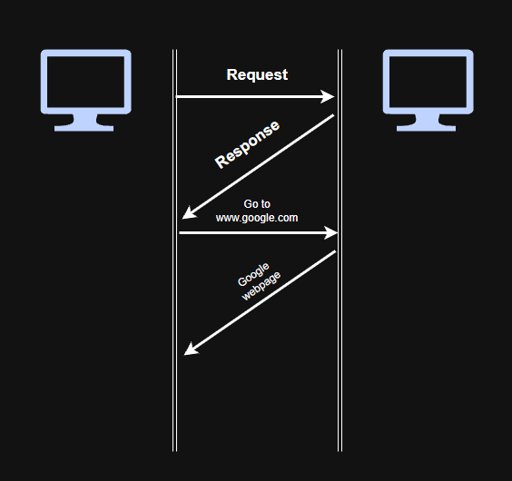
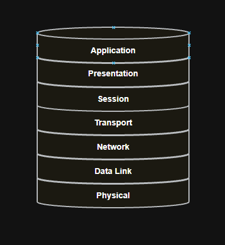
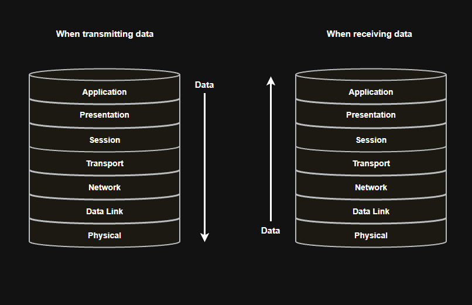
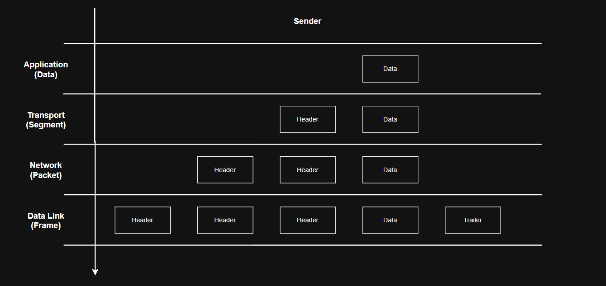
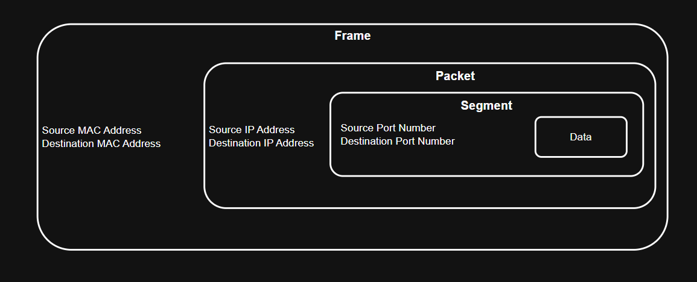
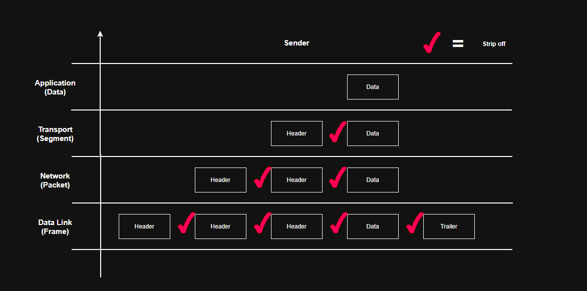
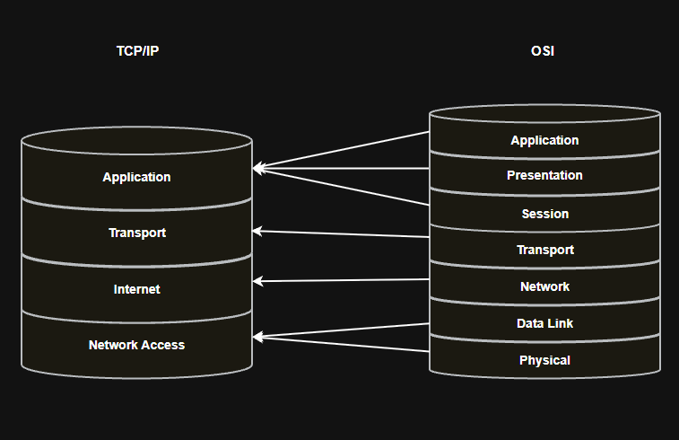

# Protocol

## 1. What Is a Protocol?

> **Protocol**: A set of rules that defines how devices communicate with each other.

Just as people follow certain conventions when communicating, computers also need agreed rules to exchange information successfully.

A protocol can define things such as:

- How communication begins and ends
- The format of messages
- How messages are transmitted
- How devices respond to received messages
- How errors are handled

For example, a device may send a request and expect a specific type of response according to the protocol being used.

Unlike conventions in human conversations, following the correct protocol is essential for computers because devices must interpret transmitted data in the same way.

## 2. OSI 7-Layer Model

> **OSI (Open Systems Interconnection) Model**: A seven-layer reference model standardised by ISO to describe how network communication functions are divided into separate layers.

The OSI model provides a conceptual framework for understanding network communication.

Each layer is responsible for different functions, and different protocols can operate at different layers.

### About each layer

| OSI Layer | Name | PDU | Example Device | Main Role |
|---|---|---|---|---|
| 7 | Application | Data | | Provides network services to applications |
| 6 | Presentation | Data | | Data formatting, encryption, encoding and compression |
| 5 | Session | Data | | Establishes, manages and terminates communication sessions |
| 4 | Transport | Segment / Datagram | | End-to-end transport, reliability and process-to-process communication |
| 3 | Network | Packet | Router | Logical addressing and routing between networks |
| 2 | Data Link | Frame | Switch, Bridge | Local delivery using frames and MAC addresses |
| 1 | Physical | Bit | Hub, Repeater | Transmits bits as physical signals |

## 3. Encapsulation and Decapsulation

### Encapsulation

When data is transmitted from a source device, it moves down through the networking layers.

As the data moves through the layers, additional protocol information is added so that the receiving device knows how to process and deliver it.

This process is called **encapsulation**.

A simplified example is:

`Data → Segment → Packet → Frame → Bits`

During encapsulation, different layers add different types of information.

| Layer | Example Information Added |
|---|---|
| Transport | Source and destination ports |
| Network | Source and destination IP addresses |
| Data Link | Source and destination MAC addresses + trailer |

The Data Link Layer typically adds both a **header** and a **trailer**.

The Physical Layer then represents the frame as physical signals for transmission.

> **Port Number**: A numerical identifier used by transport-layer protocols to identify an application process or network service.

> **IP Address**: A logical address used to identify a network interface and enable communication across IP networks.

> **MAC Address**: A Layer 2 address associated with a network interface and used for communication on a local network.

> **Trailer**: Information added to the end of a frame, commonly used for error detection.

### Decapsulation

When data reaches the destination, the process happens in reverse.

A simplified sequence is:

`Bits → Frame → Packet → Segment → Data`

As the data moves up through the layers, the receiving device examines and removes the relevant protocol information.

This process is called **decapsulation**.

**Advantages**

- We can examine network communication at different layers.
- It helps identify and troubleshoot problems when communication fails.

## 4. TCP/IP Model

> **TCP/IP Model**: A networking model associated with the TCP/IP protocol suite that describes how communication occurs across interconnected networks.

The commonly used TCP/IP model has four layers.

TCP/IP and OSI were developed separately, although their layers can be approximately mapped to each other.

The TCP/IP suite is widely used in real-world network communication, while the OSI model is commonly used as a conceptual and troubleshooting reference model.

### About each layer

| TCP/IP Layer | Corresponding OSI Layers |
|---|---|
| 4. Application | OSI 7, 6 and 5 |
| 3. Transport | OSI 4 |
| 2. Internet | OSI 3 |
| 1. Network Access | OSI 2 and 1 |

The mapping is approximate because the two models were not designed as exact equivalents.

### Protocols

Different layers use different protocols depending on their functions.

#### Example of Protocols

| TCP/IP Layer | Example Protocols / Technologies |
|---|---|
| Application | HTTP, HTTPS, DNS, SMTP, SSH |
| Transport | TCP, UDP |
| Internet | IPv4, IPv6, ICMP |
| Network Access | Ethernet, Wi-Fi |

For example, when accessing a website:

`HTTP/HTTPS → TCP → IP → Ethernet or Wi-Fi`