# Physical Layer

## 1. Role of Physical Layer

The Physical Layer defines how network devices are physically connected and how bits are transmitted as physical signals through a transmission medium.

Depending on the medium, these signals can be electrical, optical, or wireless signals.

### Electrical Signal

> **Electrical Signal**: A time-varying change in voltage or current that carries information from one point to another.

There are two main types of electrical signals.

#### Analog Signal

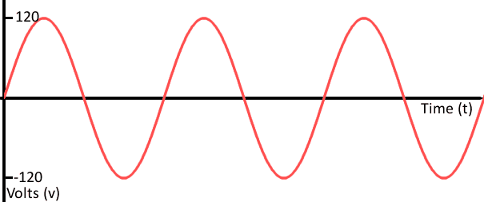

> **Analog Signal**: A continuous signal whose value changes smoothly over time.

Analog signals have traditionally been used in systems such as wired telephones and radio broadcasting.

#### Digital Signal

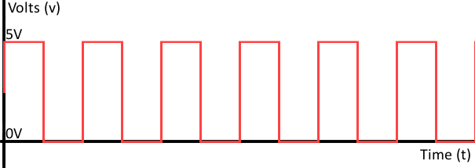

> **Digital Signal**: A signal represented using discrete signal levels.

Digital signals are commonly used in computer and digital communication systems.

### Bit and Digital Signal

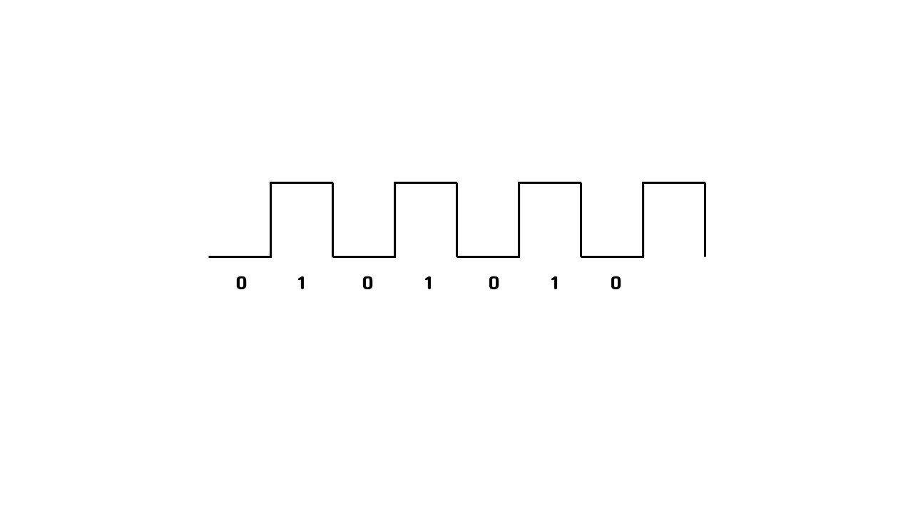

The data unit of the Physical Layer is a **bit**.

A bit can have a value of `0` or `1`, and the Physical Layer represents these bits using physical signals. 

Depending on the encoding method being used, different signal levels or signal changes can represent `0` and `1`.

The sender converts bits into signals for transmission. 

The receiver then converts the received signals back into bits, which are passed up through the network layers until the original data can be processed.

#### LAN Card (NIC, Network Interface Card)

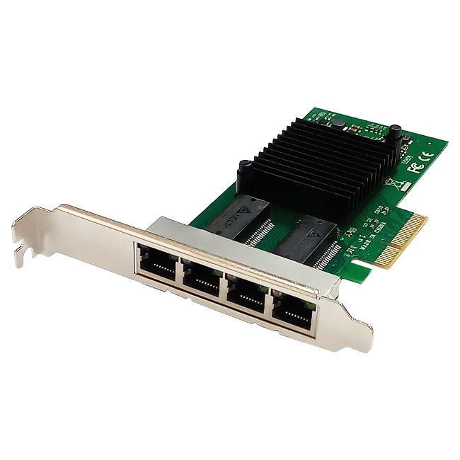

> **LAN Card (NIC)**: A hardware component that allows a device to connect to a network and transmit or receive network signals.

A NIC converts data into signals suitable for the network medium and converts received signals back into data that the computer can process.

A NIC is an essential component for connecting a computer or other device to a network.

## 2. Cable

> **Cable**: A physical transmission medium used to connect network devices and carry signals between them.

NIC: Starting point and destination of the transmitted signal

Cable: Path through which the signal travels

### Types of Cables

#### Coaxial Cable

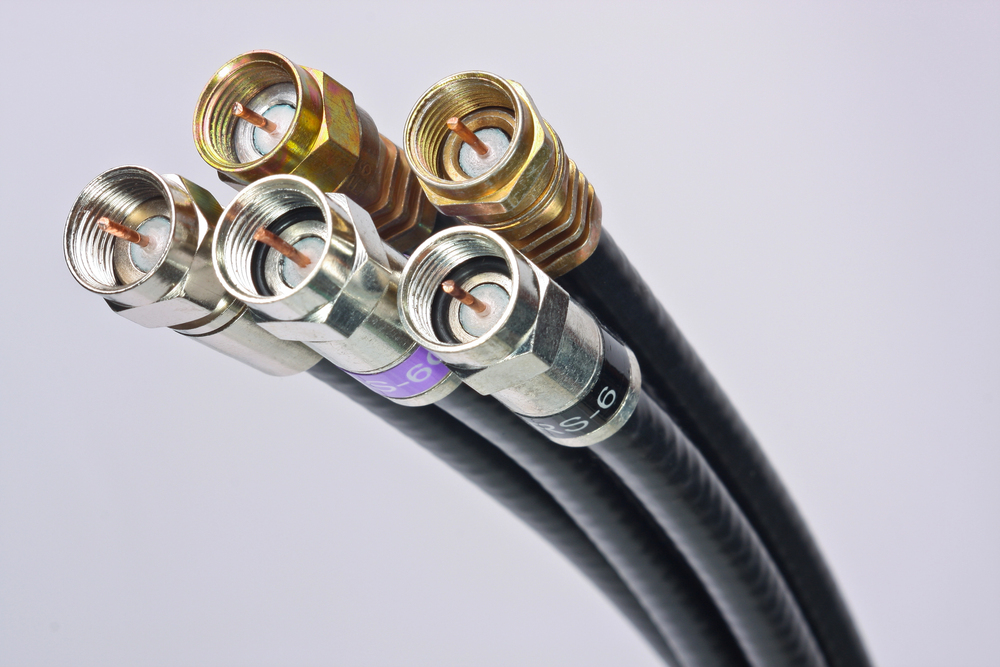

> **Coaxial Cable**: A cable that carries electrical signals through a central copper conductor surrounded by insulation and shielding.

Coaxial cables are commonly used for cable television and broadband cable networks.

#### UTP Cable (Unshielded Twisted Pair Cable)

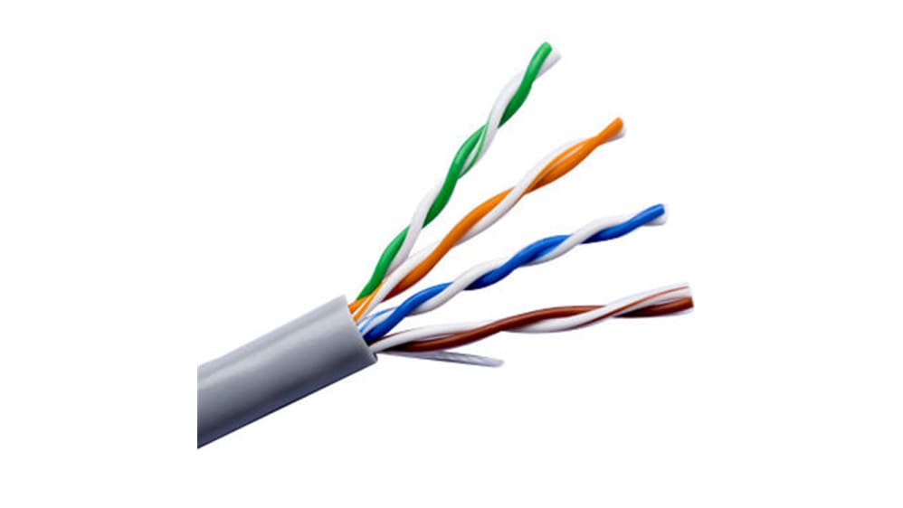

> **UTP Cable**: A twisted-pair cable without additional metallic shielding.

The wires are twisted together to reduce electromagnetic interference and crosstalk.

UTP is widely used in Ethernet networks.

#### FTP Cable (Foiled Twisted Pair Cable)

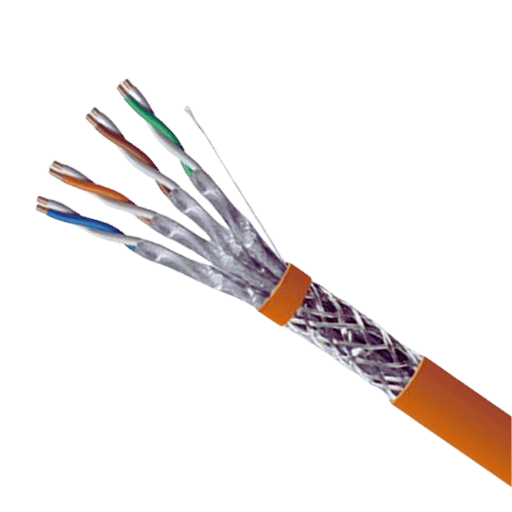

> **FTP Cable**: A twisted-pair cable that uses metallic foil shielding around the wire pairs.

The foil helps reduce electromagnetic interference from external sources.

Because of its additional shielding, this type of cable can be useful in environments with higher levels of electrical interference, such as industrial environments.

#### STP Cable (Shielded Twisted Pair Cable)

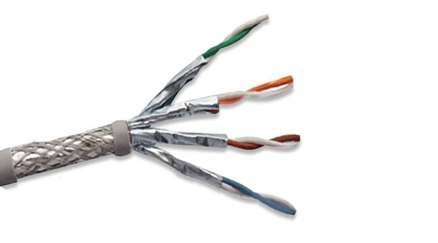

> **STP Cable**: A twisted-pair cable that uses additional shielding to protect the transmitted signal from electromagnetic interference.

The shielding helps reduce external noise and interference.

However, STP cables are generally more expensive and more complex to install than UTP cables.

#### Noise

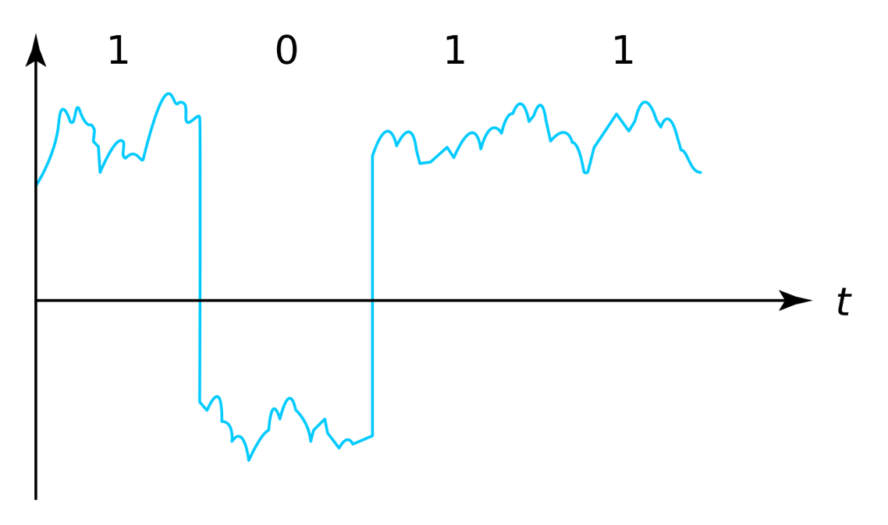

Selecting an appropriate cable is important because external electromagnetic noise can interfere with electrical signals and cause signal distortion or transmission errors.

## 3. Repeater and Hub

When an electrical signal travels over a long distance, its strength gradually decreases. This phenomenon is called **attenuation**.

Repeaters and hubs can regenerate weakened signals to allow them to travel further.

### Repeater

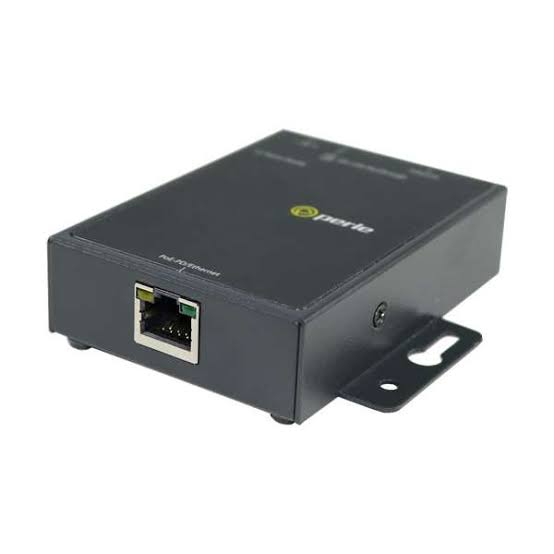

> **Repeater**: A Physical Layer device that receives a weakened signal, regenerates it, and retransmits it.

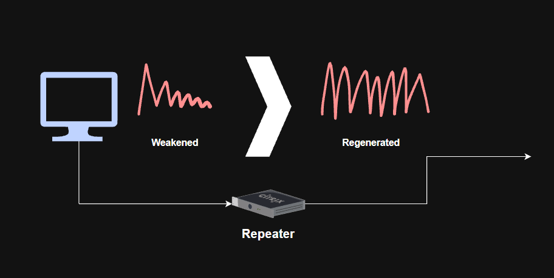

As shown in the picture, the repeater regenerates the signal before transmitting it to the next network segment.

Repeaters were commonly used to extend the distance of older network connections, but dedicated repeaters are uncommon in modern Ethernet networks.

### Hub

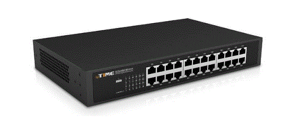

> **Hub**: A multiport Physical Layer device that receives a signal on one port and repeats it to all other connected ports.

A hub can be considered a **multiport repeater**.

Unlike a switch, a hub cannot determine the specific destination of a frame.

Therefore, when one device transmits data to a hub, the hub repeats the signal to every other connected device.

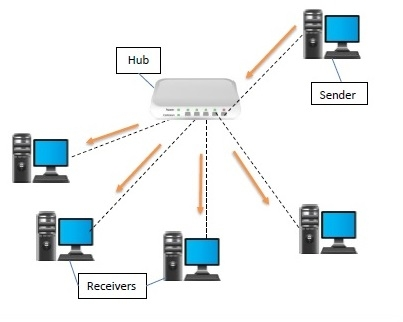

Because hubs do not intelligently forward traffic, they are sometimes called **dummy hubs**.

Hubs were commonly used with twisted-pair Ethernet cables such as UTP, but they have largely been replaced by network switches in modern networks.