# Data Link Layer

## 1. Role of Data Link Layer

The Data Link Layer defines how data is transferred across a local link, how devices are identified using MAC addresses, and how transmission errors are detected.

### Main Roles of Data Link Layer

- Organise data into frames.
- Identify network interfaces using MAC addresses.
- Detect transmission errors.
- Control access to the communication medium to reduce or manage collisions.

## 2. Error Detection and Collision Avoidance

### Line Control

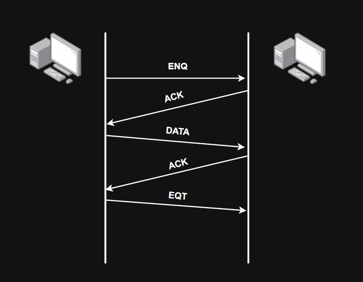

> **Line Control**: A method of coordinating data transmission between communicating devices.

In some communication systems, the sender can transmit an **ENQ (Enquiry)** control character to request communication.

The receiver can respond with an **ACK (Acknowledgement)** to confirm the request.

When communication is complete, an **EOT (End of Transmission)** control character can be used to indicate the end of the transmission.

### Error Control

> **Error Control**: A set of techniques used to detect transmission errors and maintain data integrity.

During transmission, data can be corrupted by interference, signal degradation, or other communication errors.

There are several methods for detecting or correcting errors.

#### Parity Check

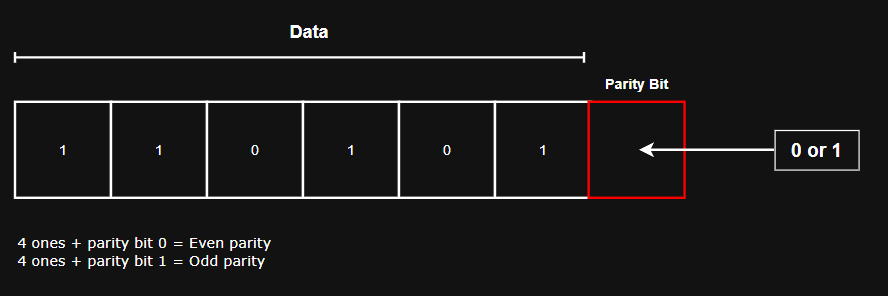

A sender and receiver use an agreed parity method.

- Even parity
- Odd parity
- Row parity
- Column parity

The sender adds one or more parity bits to the data.

The receiver checks whether the received bits satisfy the expected parity.

If the received data does not match the expected parity, the receiver can detect that an error has occurred.

#### CRC

The sender calculates a **CRC (Cyclic Redundancy Check)** value based on the data and transmits it with the frame.

The receiver performs the same CRC calculation.

If the calculated result does not match the received CRC value, the receiver can determine that the data was corrupted during transmission.

#### Checksum

The sender calculates a checksum value from the data and sends the value along with the data.

The receiver calculates the checksum again using the received data.

If the two values do not match, the receiver can determine that the data has been corrupted.

#### Hamming Code

1. Additional parity bits are added to the original data.
2. The parity bits are positioned among the data bits.
3. When an error occurs, the receiver analyses the parity results to determine the location of the incorrect bit.
4. Depending on the Hamming code being used, the receiver can correct certain errors, such as a single-bit error.

Unlike basic parity checking, Hamming code can identify the position of certain errors and correct them.

#### Hashing

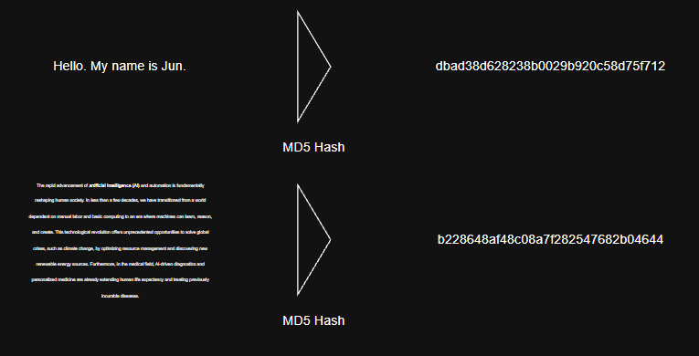

The sender calculates a hash value from the original data and sends or stores it together with the data.

The receiver performs the same hash operation on the received data.

A hash function produces a fixed-length output, and even a small change in the original data can produce a very different hash value.

If the hash values do not match, the receiver can determine that the data has changed.

### Flow Control

> **Flow Control**: A method used to prevent a sender from transmitting data faster than the receiver can process it.

Flow control helps match the transmission rate of the sender with the processing capacity of the receiver.

#### Stop and Wait

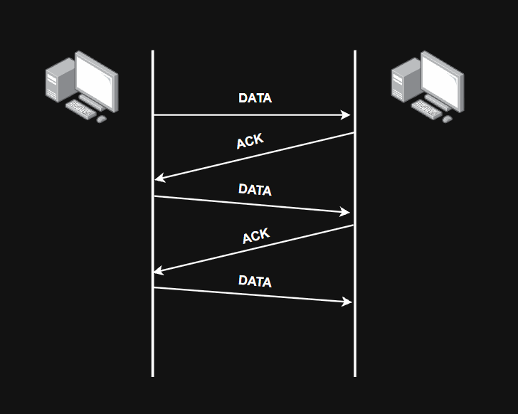

Stop and Wait is one of the simplest flow control methods.

In the Stop and Wait method, the sender transmits one unit of data and waits for an **ACK (Acknowledgement)** from the receiver before sending the next one.

## 3. Ethernet and Communication Method

### Ethernet

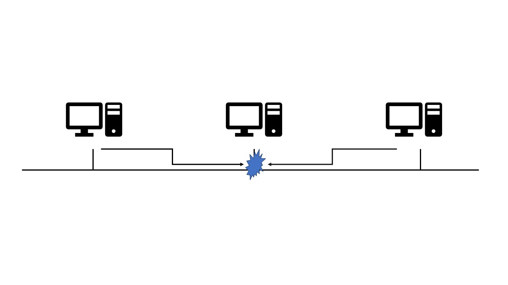

> **Ethernet**: A family of networking standards commonly used for communication in LAN environments.

In shared Ethernet environments, such as networks using hubs, collisions can occur when multiple devices transmit at the same time.

> **Collision Domain**: An area of a network in which simultaneous transmissions can interfere with each other and cause a collision.

All devices connected to the same hub belong to the same collision domain because a hub repeats received signals to all connected ports.

Traditional shared Ethernet uses **CSMA/CD (Carrier Sense Multiple Access with Collision Detection)** to manage collisions.

> **CSMA/CD**: A method in which a device listens to the communication medium before transmitting and detects whether a collision occurs during transmission.

Before transmitting, a device checks whether the medium is currently in use.

If the medium is available, the device begins transmission.

While transmitting, it continues monitoring the medium for possible collisions.

### Collision Avoiding Method

#### 1. 1-Persistent

The device checks whether the communication medium is being used.

If the medium is available, it immediately transmits the data.

If the medium is busy, it continues checking until the medium becomes available.

#### 2. Non-Persistent

The device checks whether the communication medium is being used.

If the medium is available, it transmits immediately.

If the medium is busy, it waits for a random period before checking again.

#### 3. p-Persistent

This method combines probability with carrier sensing.

If the medium is busy, the device waits until it becomes available.

When the medium becomes available, the device transmits with a certain probability `p`. Otherwise, it waits before trying again.

#### Additional Information

- Nowadays, hubs have largely been replaced by switches.
- Modern switched Ethernet usually operates in full-duplex mode, so collisions do not normally occur and CSMA/CD is generally unnecessary.

### Transmission Method

#### Simplex Transmission

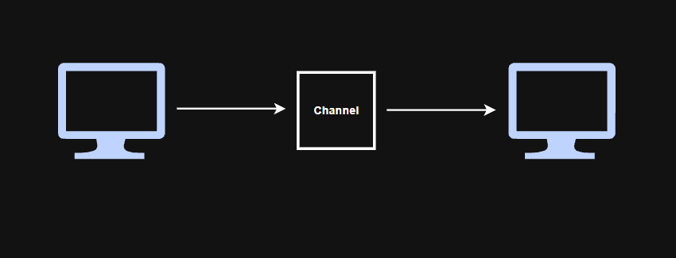

> **Channel**: A communication path used to carry data.

Simplex transmission allows communication in only one direction.

Therefore, one device acts as the sender and the other acts as the receiver.

Simplex communication has traditionally been used in systems such as television and radio broadcasting.

#### Duplex Transmission

There are two main types of duplex transmission.

1. **Half Duplex**

   Half-duplex communication allows both devices to transmit data, but not at the same time.

   Because only one device can transmit at a time, collisions can occur in shared Ethernet environments such as networks using hubs.

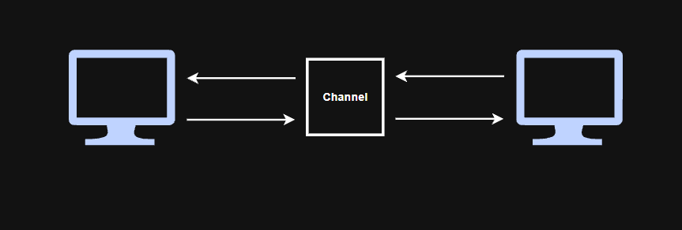

2. **Full Duplex**

   Full-duplex communication allows both devices to transmit and receive data at the same time.

   Modern switched Ethernet commonly uses full-duplex communication.

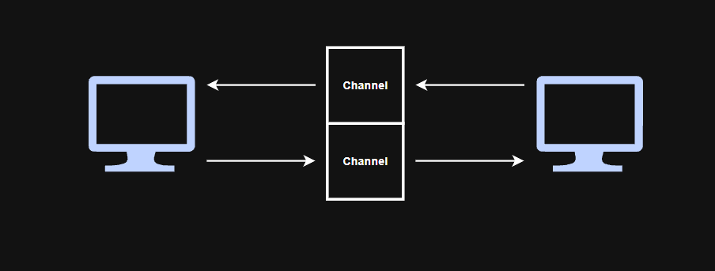

## 4. MAC Address (Media Access Control Address)

In the Data Link Layer, devices within a local network use MAC addresses for local frame delivery.

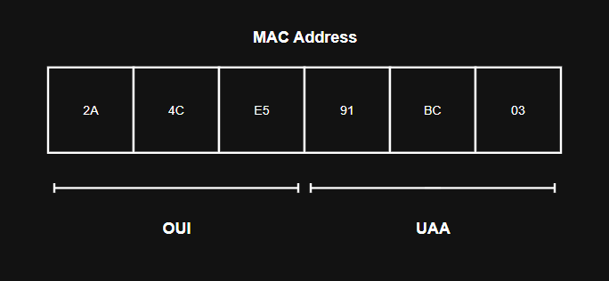

> **MAC Address**: A Layer 2 address associated with a network interface.

A traditional Ethernet MAC address is represented using **48 bits**.

For globally assigned MAC addresses, the first 24 bits typically identify the organisation through an **OUI (Organizationally Unique Identifier)**, while the remaining 24 bits, called **UAA (Universally Administered Address)**, are assigned by that organisation to identify the interface.

> **OUI**: A 24-bit identifier assigned by IEEE to an organisation or manufacturer.

> **UAA** : The part of a MAC address assigned by the manufacturer to uniquely identify a network interface.

A MAC address is usually represented using hexadecimal numbers separated by colons (`:`) or hyphens (`-`).

Example:

`1C-1B-B5-08-A4-26`

`1C:1B:B5:08:A4:26`

At Layer 2, when data is encapsulated into an Ethernet frame, the Data Link Layer adds an Ethernet header.

The header includes the source MAC address, destination MAC address and **EtherType** information.

The EtherType field indicates which upper-layer protocol is carried inside the Ethernet frame.

### Protocol

> **IPv4**: A 32-bit Internet Protocol widely used for logical addressing and communication between networks.

> **IPv6**: A 128-bit Internet Protocol introduced partly to provide a much larger address space than IPv4.

> **ARP**: A protocol used in IPv4 networks to map an IP address to a MAC address on the local network.

#### ARP

If Computer A needs to communicate with Computer B on the same local network but does not know Computer B's MAC address, it can use ARP to discover it.

**ARP Process**

1. Computer A broadcasts an **ARP Request** containing Computer B's IP address.
2. Devices within the broadcast domain receive the request and compare the target IP address with their own IP address.
3. Computer B recognises its own IP address and sends an **ARP Reply** containing its MAC address.
4. Computer A stores the IP-to-MAC mapping in its ARP cache.
5. Computer A can then use Computer B's MAC address when creating Ethernet frames for subsequent communication.

> **Broadcast**: A transmission intended for all devices within the same broadcast domain.

## 5. Switch

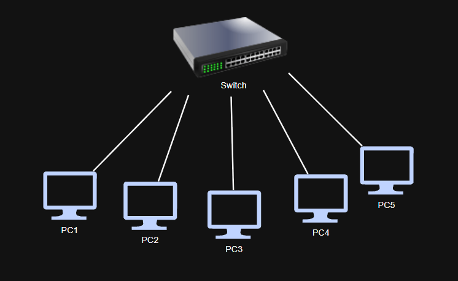

> **Switch**: A network device that connects devices within a LAN and forwards Ethernet frames based on MAC addresses.

A switch performs a similar basic connectivity role to a hub, but the major difference is that a switch can forward frames toward a specific destination port instead of repeating them to every port.

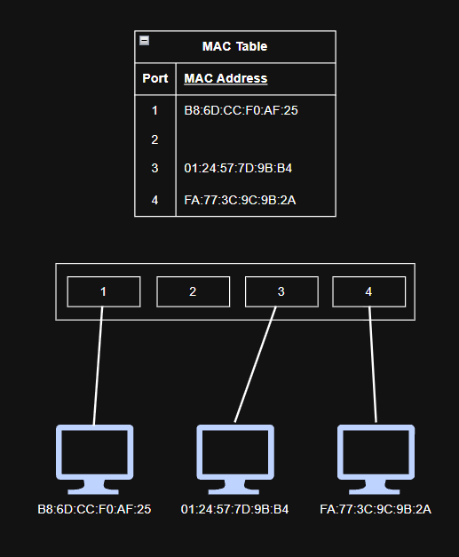

Switches maintain a **MAC address table**.

The MAC address table records MAC addresses and the switch ports through which those addresses were learned.

A switch learns MAC addresses by examining the **source MAC address** of incoming Ethernet frames.

However, if the destination MAC address is not currently in the MAC address table, the switch uses a different process.

### When the destination MAC address is unknown.

1. Computer A sends an Ethernet frame addressed to Computer B.
2. The switch receives the frame and learns Computer A's MAC address from the frame's source MAC address.
3. The switch checks its MAC address table but cannot find Computer B's destination MAC address.
4. The switch **floods** the frame out of all appropriate ports except the port on which it was received.
5. Computer B receives the frame, while other devices discard it because the destination MAC address does not match their own.
6. When Computer B sends a frame back, the switch learns Computer B's MAC address from the source MAC address and records the corresponding port in its MAC address table.
7. Future frames addressed to Computer B can then be forwarded directly to the appropriate port.

*A switch does not discover the destination MAC address on behalf of the sending computer. ARP is responsible for discovering the MAC address associated with an IPv4 address, while the switch uses its MAC address table to determine which port should receive an Ethernet frame. This forwarding process is commonly called **MAC address filtering or switching**.*

#### Broadcast vs Flooding

- Broadcast → Traffic is intentionally sent to all devices within the broadcast domain.

- Flooding → A switch forwards a frame out of multiple ports because the destination location is unknown.