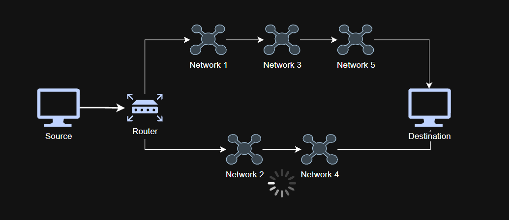
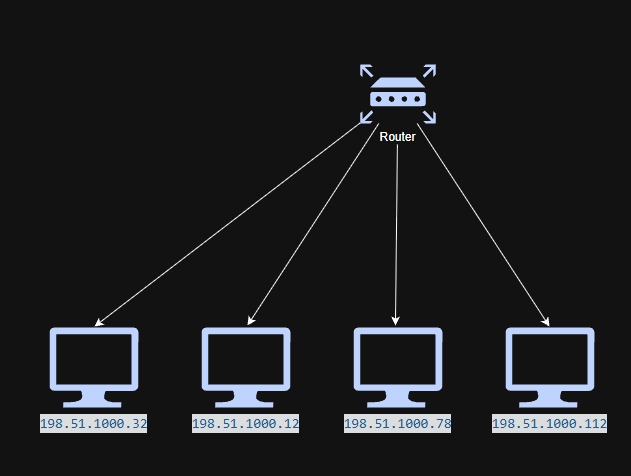
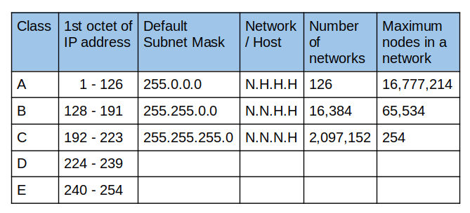
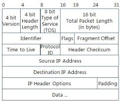
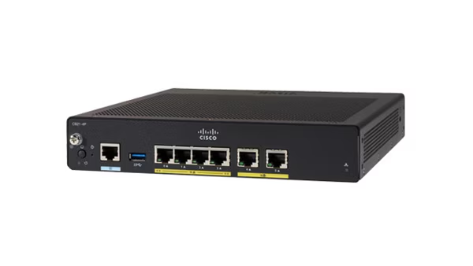

# Network Layer

## 1. Role of Network Layer

The main role of the Network Layer is delivering packets from a source network to a destination network.

It provides **source-to-destination packet delivery** across interconnected networks.

The main device operating at the Network Layer is the **Router**.

There are two major functions of the Network Layer: **Routing** and **Forwarding**.

### Routing

> **Routing**: The process of learning and determining possible paths through a network.

Routers learn network topology and available routes, then store this information in a **routing table**.

Through this process, routers can determine which paths are available to reach a destination network.

### Forwarding

> **Forwarding**: The process of sending a packet toward its destination based on information in the routing table.

Once a router has determined the appropriate route, it forwards the packet to the next device along that path.

As the packet travels toward its destination, it may pass through multiple routers. 

Each router it passes through is called a **hop**.

## 2. IP Protocol

At the Network Layer, devices use IP addresses for logical addressing and communication across networks.

There are two commonly discussed types of IP addresses:

- Public IP addresses
- Private IP addresses

### Public IP

> **Public IP**: A globally routable IP address that can be used for communication across the Internet.

Public IP addresses are typically allocated through Internet service providers or other network organisations.

ISPs are commonly telecommunications companies such as Telstra in Australia, SK Telecom in Korea, and Verizon in the United States.

Devices or networks connected to the Internet can communicate using public IP addresses.

Public IP addresses may be either **static** or **dynamically assigned**, depending on the network configuration and service provider.

### Private IP

> **Private IP**: An IP address reserved for use within private networks.

Private IP addresses are commonly used inside homes, companies, schools, and other internal networks.

They can be used freely inside private networks but are not directly routable across the public Internet.

Devices using private IP addresses commonly access the Internet through technologies such as **NAT (Network Address Translation)**.

### IPv4

There are two major versions of the Internet Protocol: **IPv4** and **IPv6**.

IPv6 was developed partly to address the limited IPv4 address space.

However, in this section, I will mainly cover IPv4 because it is still widely used.

#### Characteristics of IP

IP provides a **best-effort delivery service**.

IP is also connectionless, meaning that it does not establish a dedicated connection before sending packets.

IP itself does not guarantee:

- Successful delivery
- Retransmission of lost packets
- Notification of lost packets
- Acknowledgements
- Packet ordering

Packets may be lost, duplicated, delayed, or corrupted during transmission.

IP provides basic packet delivery, while upper-layer protocols can provide reliability depending on the application's requirements.

### IPv4 Address Structure

An IPv4 address is **4 bytes (32 bits)** long and is divided into four 8-bit sections called **octets**.

**Example**

Binary:

`01111111 00000000 00000000 00000001`

Decimal:

`127.0.0.1`

The decimal representation separated by dots is called **dotted-decimal notation**.

Each octet ranges from `0` to `255`.

### Two Parts of an IP Address

Every IPv4 address can be divided into a **Network Portion** and a **Host Portion**.

> **Network Portion**: Identifies the network to which the address belongs.

> **Host Portion**: Identifies a specific host or network interface within that network.

#### Network ID vs Host ID

The Network ID identifies the entire network.

Therefore, hosts belonging to the same subnet share the same network portion.

The Host ID identifies a specific host within that network.

Therefore, within the same subnet, two devices cannot normally use the same IP address.

**Example**

If the network is:

`198.51.100.0/24`

Possible host addresses include:

- `198.51.100.32`  
  Network Portion: `198.51.100`  
  Host Portion: `.32`
- `198.51.100.12`
- `198.51.100.78`

### Network Address & Broadcast Address

There are two important addresses in a traditional IPv4 subnet that are not normally assigned to hosts.

They are the **Network Address** and **Broadcast Address**.

#### Network Address

The first address in a subnet is the **Network Address**.

For the network address, all host bits are `0`.

**Example**

`198.51.100.0` ← Network Address for `198.51.100.0/24`

#### Broadcast Address

The last address in a traditional IPv4 subnet is the **Broadcast Address**.

For the broadcast address, all host bits are `1`.

**Example**

`198.51.100.255` ← Broadcast Address for `198.51.100.0/24`

Usable Host Range

Usable host addresses are generally located between the Network Address and the Broadcast Address.

- `First usable address = Network Address + 1`
- `Last usable address = Broadcast Address - 1`

### Subnet Mask / Net Mask

To identify which bits belong to the network portion and which belong to the host portion, IPv4 uses a **subnet mask**.

A subnet mask is also 32 bits long.

A bit of `1` corresponds to the network portion, while a bit of `0` corresponds to the host portion.

Network bits are written on the left, followed by host bits on the right.

**Example**

Subnet Mask:

`255.255.255.0`

Binary:

`11111111.11111111.11111111.00000000`

Therefore, this subnet mask contains **24 network bits** and **8 host bits**.

#### Prefix/CIDR Notation

Instead of writing the full subnet mask, we can represent it using the number of network bits.

**Example**

- `255.255.255.0` → `/24`
- `255.255.0.0` → `/16`

### Address Class

IPv4 originally used a **classful addressing system**.

There were five address classes.

| Class | First Octet |
|---|---|
| A | 1–126 |
| B | 128–191 |
| C | 192–223 |
| D | 224–239 (Multicast) |
| E | 240–255 (Experimental / Reserved) |

`127.0.0.0/8` is reserved for loopback addresses and is therefore not part of the usable Class B range.

This repository will mainly cover Classes A–C because they were historically used for normal unicast addressing.

| Class | Default Mask | Prefix | Network Bits | Host Bits |
|---|---|---|---|---|
| A | 255.0.0.0 | /8 | 8 | 24 |
| B | 255.255.0.0 | /16 | 16 | 16 |
| C | 255.255.255.0 | /24 | 24 | 8 |

These are the default boundaries used under traditional **classful addressing**.

### Calculating Usable Host Addresses

For traditional IPv4 subnets, the number of usable host addresses can usually be calculated using:

`2^(number of host bits) - 2`

The reason for subtracting 2 is that one address is reserved as the Network Address and another as the Broadcast Address.

**Example**

`/24` → 8 host bits

`2⁸ = 256`

`256 - 2 = 254 usable host addresses`

This formula applies to typical IPv4 subnets, although there are special cases such as `/31` and `/32`.

### Classless Addressing / CIDR (Classless Inter-Domain Routing)

> **Classless Addressing / CIDR**: A method of allocating IP address ranges using variable-length network prefixes instead of fixed address classes.

Under traditional classful addressing, a Class C network provides 254 usable host addresses.

However, if a network only requires a small number of addresses, allocating an entire `/24` network can waste address space.

**Classless addressing** allows the network and host boundary to be selected more flexibly according to actual network requirements.

*As a subnet becomes smaller, fewer host addresses are available within that subnet. In traditional IPv4 subnets, each subnet also reserves a Network Address and a Broadcast Address.*

### Header

At the Network Layer, an IP packet contains additional control information in its header, not only source and destination IP addresses.

### Special IPv4 Addresses

1. **Localhost / Loopback**

   Network range:

   `127.0.0.0/8`

   **Common example**

   `127.0.0.1`

   This address allows a computer to communicate with and test its own TCP/IP stack.

   For example, when testing a local web server running through XAMPP, you may access:

   `http://localhost/`

   `localhost` commonly resolves to the loopback address `127.0.0.1`.

2. **Link-Local**

   IPv4 link-local addresses use the range:

   `169.254.0.0/16`

   These addresses can be automatically assigned when normal IP configuration, such as DHCP, is unavailable.

   They allow devices on the same local link to communicate with each other without manually configured addresses.

## 3. Router

A router is a Network Layer device that connects different networks and forwards packets between them.

Similar to how switches maintain MAC address tables, routers maintain **routing tables** containing information about reachable networks.

### How Routers Learn Routes

Routers can learn routes in multiple ways.

1. **Static Routing**

   Routes are manually configured by a network administrator.

   The administrator explicitly tells the router how to reach particular networks.

2. **Dynamic Routing**

   Routes are learned using **routing protocols**.

   In this method, routers exchange routing information and automatically learn available network paths.

### Longest Prefix Match

When a router has several routes that match a destination IP address, it chooses the route with the **longest prefix match**.

**Example**

If the destination is:

`10.10.20.55`

and the routing table contains:

- `10.0.0.0/8`
- `10.10.0.0/16`
- `10.10.20.0/25`

The router selects:

`10.10.20.0/25`

because `/25` provides the longest and therefore most specific matching prefix.

### Routing Metric

> **Routing Metric**: A value used by a routing protocol to evaluate and compare possible routes.

Different routing protocols may use different metrics when determining which route is preferred.

Examples of factors that may be used include:

- Hop count
- Bandwidth
- Delay
- Cost

### Default Gateway

The **Default Gateway** is important when a device needs to communicate with a destination outside its own local network.

> **Default Gateway**: The router or Layer 3 device to which a host sends packets when the destination is outside its local network.

For most hosts, the default gateway is the IP address of the router interface connected to the same local network.

