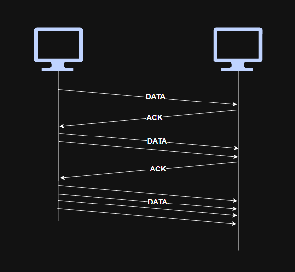
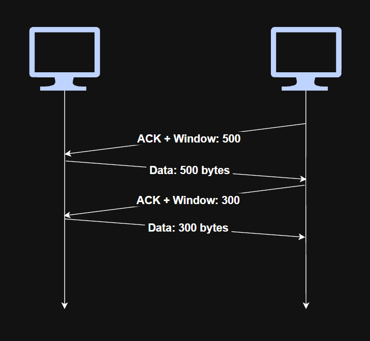
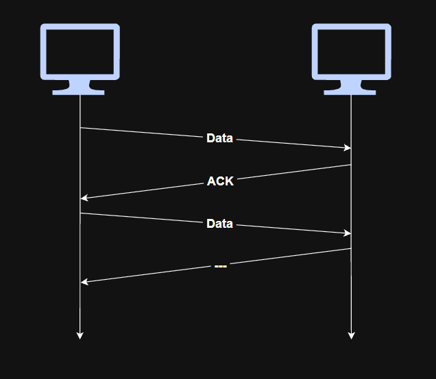
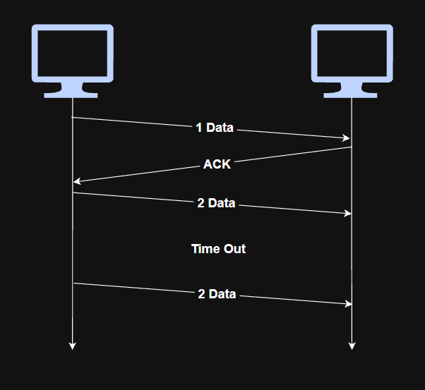
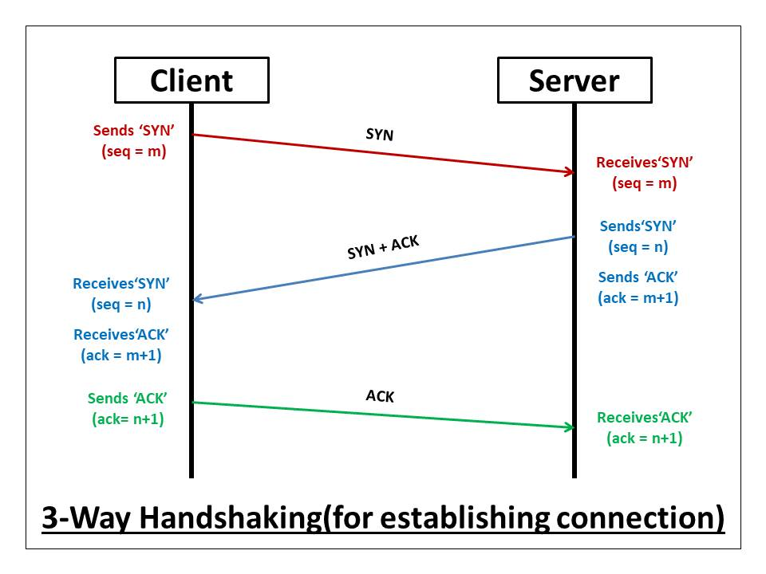
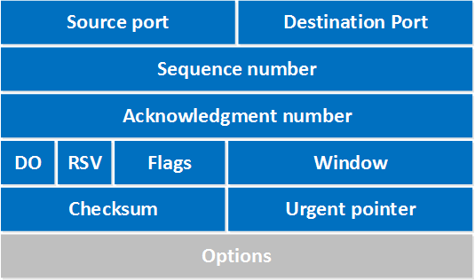
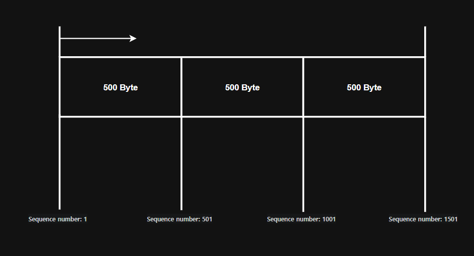
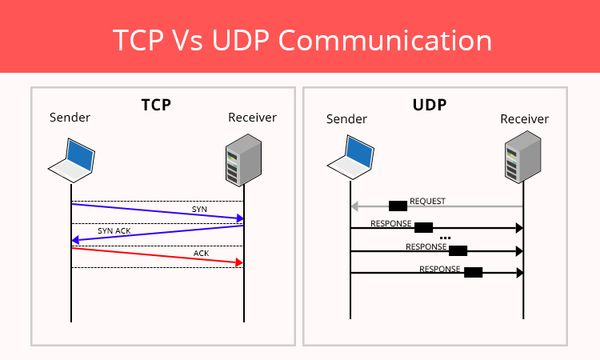
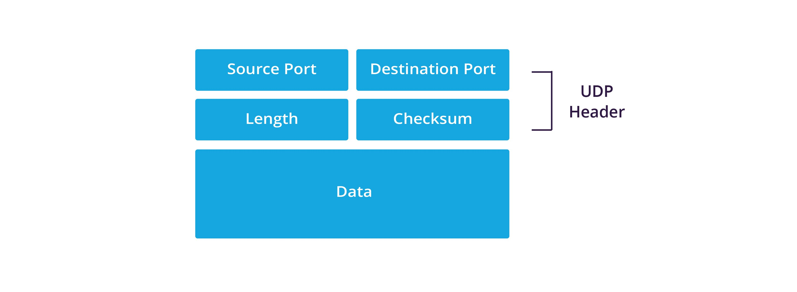
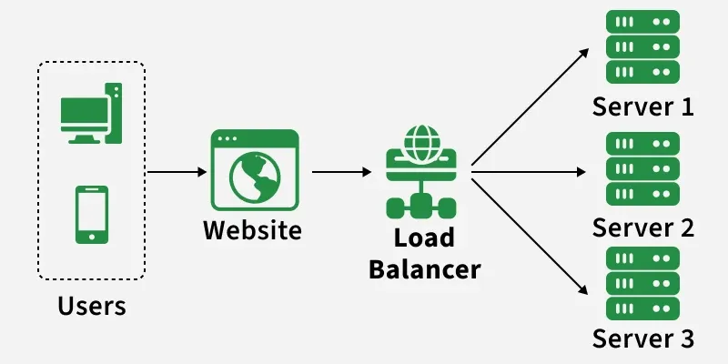

# Transport Layer

## 1. Role of Transport Layer

The main role of the Transport Layer is to provide **process-to-process communication** between applications.

It identifies which application should receive the data using **port numbers** and can also provide reliability, flow control, and error recovery depending on the transport protocol being used.

## 2. 3 Methods Avoiding Errors

### Congestion Control

> **Congestion Control**: Controlling the amount of data transmitted to prevent excessive congestion in the network.

TCP adjusts the amount of data it sends according to network conditions.

At the beginning of a connection, TCP may increase the amount of data transmitted as acknowledgements are successfully received.

If packet loss is detected through a timeout or repeated duplicate ACKs, TCP reduces its transmission rate.

Afterwards, if acknowledgements continue to arrive successfully, TCP gradually increases the amount of data transmitted again.

Through this process, TCP adjusts its sending rate according to network conditions.

### Flow Control

> **Flow Control**: Controlling the transmission rate so that the sender does not send data faster than the receiver can process it.

The receiver informs the sender how much data it can currently accept using the TCP **receive window**.

The sender limits the amount of unacknowledged data according to this value.

This prevents the receiver's buffer from being overwhelmed.

### Error Control

In TCP, errors and packet loss can be detected using acknowledgements, sequence numbers, checksums, and timeouts.

#### ACK Response

When the receiver successfully receives TCP data, it sends an **ACK (Acknowledgement)** indicating the next sequence number it expects.

If expected acknowledgements are not received, the sender may determine that data has been lost.

#### Time Out

If the sender does not receive an expected acknowledgement within a certain period of time, a **timeout** occurs.

The sender may then retransmit the missing data.

### The Cases of Retransmitting

TCP may retransmit data when:

1. A segment is lost.
2. A timeout occurs before the expected acknowledgement is received.
3. Duplicate ACKs indicate that a segment may be missing.

Corrupted segments can also be detected using the TCP checksum and discarded, which may eventually result in retransmission.

## 3. TCP and UDP

At the Transport Layer, communication commonly uses either TCP or UDP depending on the application's requirements.

> **Connection-oriented communication**: Communication that establishes a connection before transmitting application data and can provide reliable delivery.

Connection-oriented communication commonly uses the TCP protocol.

> **Connectionless communication**: Communication that sends data without establishing a connection beforehand.

Connectionless communication commonly uses the UDP protocol.

### TCP

#### 3 Way Handshake

> **3 Way Handshake**: The process used by TCP to establish a connection and synchronise initial sequence numbers between two devices.

TCP (Transmission Control Protocol) establishes a connection using the **3-Way Handshake**.

**Process of 3 Way Handshake**

1. The client sends a **SYN** containing its initial sequence number.
2. The server responds with **SYN-ACK**. The ACK acknowledges the client's sequence number, while the SYN contains the server's own initial sequence number.
3. The client sends an **ACK** acknowledging the server's sequence number.

After this process, the TCP connection is established.

#### TCP Header

At the Transport Layer, the TCP header contains information such as the following.

#### Port

> **Port**: A numerical identifier used to identify an application process or network service.

There are **65,536 possible port numbers**, ranging from `0` to `65535`.

They are commonly classified into three ranges:

- `0–1023`: Well-known ports
- `1024–49151`: Registered ports
- `49152–65535`: Dynamic / Private ports

#### Well-Known Ports

| Port | Protocol | Objective |
|---|---|---|
| 20 | FTP | FTP data transfer |
| 21 | FTP | FTP control connection |
| 22 | SSH | Secure remote access |
| 23 | Telnet | Unencrypted remote terminal access |
| 25 | SMTP | Email transmission |
| 53 | DNS | Domain name resolution |
| 80 | HTTP | Web communication |
| 110 | POP3 | Retrieving emails |
| 123 | NTP | Time synchronisation |
| 443 | HTTPS | Encrypted web communication |

**Example**

When an email client sends mail using SMTP, it may connect to a mail server using TCP port `25`.

The destination port allows the receiving system to identify which network service should receive the data.

#### Sequence Number and Acknowledgement Number

> **Sequence Number**: A number used to identify the position of transmitted bytes within a TCP data stream.

> **Acknowledgement Number**: A number indicating the next byte that the receiver expects to receive.

Large amounts of data are divided into smaller segments before transmission.

**Example**

Suppose 1,500 bytes of data are divided into three TCP segments containing 500 bytes each.

For a simplified example, if the first byte begins with sequence number `1`:

- First segment → Sequence Number `1`
- Second segment → Sequence Number `501`
- Third segment → Sequence Number `1001`

If the receiver successfully receives the first 500 bytes, it can send:

`ACK = 501`

This means:

*"I have successfully received everything before byte 501, and I expect byte 501 next."*

Through sequence and acknowledgement numbers, TCP can detect missing or incorrectly ordered data and maintain the correct byte sequence.

#### Window Size (Flow Control)

> **Window Size**: A value used to indicate how much data the receiver is currently prepared to accept.

During TCP communication, each side advertises its receive window.

The sender uses this information to control how much unacknowledged data it can transmit without overwhelming the receiver.

The window size can change during the connection depending on the receiver's available buffer space.

#### Code Bit

TCP contains several control flags.

The default value of each flag is `0`.

When a particular flag is activated, its corresponding bit becomes `1`.

| Item | Instruction |
|---|---|
| URG | Urgent Pointer field is significant |
| ACK | Acknowledgement field is significant |
| PSH | Requests that received data be passed to the application promptly |
| RST | Resets or terminates a connection abnormally |
| SYN | Synchronises sequence numbers when establishing a connection |
| FIN | Indicates that the sender has finished sending data |

These control flags include the flags used during the TCP 3-Way Handshake.

**When the connection establishment begins**

| URG | ACK | PSH | RST | SYN | FIN |
|---|---|---|---|---|---|
| 0 | 0 | 0 | 0 | 1 | 0 |

This represents the initial **SYN** segment.

**When a device requests to close the connection**

| URG | ACK | PSH | RST | SYN | FIN |
|---|---|---|---|---|---|
| 0 | 1 | 0 | 0 | 0 | 1 |

A `FIN + ACK` combination can appear during normal TCP connection termination.

TCP uses these flags to manage the state of a connection.

### UDP

UDP (User Datagram Protocol) sends datagrams without establishing a connection beforehand.

It has less overhead than TCP because it does not provide TCP-style acknowledgements, retransmission, sequencing, flow control, or congestion control.

Therefore, UDP can provide lower-latency communication, but UDP itself does not guarantee delivery, ordering, or retransmission of lost data.

UDP is commonly used for applications such as:

- DNS
- Real-time voice and video
- Online games
- Streaming
- Some broadcast and multicast communication

#### UDP Header

Unlike TCP, UDP has a much simpler header.

A UDP header contains:

- Source Port
- Destination Port
- Length
- Checksum

## Load Balancer

If too much network traffic is directed to a single server, that server may become overloaded.

Therefore, traffic can be distributed across multiple servers. This process is called **Load Balancing**.

> **Load Balancer**: A device or service that distributes incoming network traffic across multiple servers.

> **Scale Out**: Increasing system capacity by adding more servers instead of upgrading a single server.

Network traffic from clients is sent to the load balancer first. The load balancer then distributes the traffic to backend servers according to a specific load-balancing method.

### Methods of Load Balancing

1. **Round Robin**

Round Robin distributes incoming requests to each server in sequence.

For example:

`Server 1 → Server 2 → Server 3 → Server 1 ...`

2. **Weighted Round Robin**

Weighted Round Robin assigns different weights to servers.

Servers with higher weights receive a larger proportion of the incoming traffic.

This method is useful when some servers have greater processing capacity than others.

3. **Random**

Incoming traffic is distributed randomly among the available servers.

4. **Hash**

A hash value is calculated using information from the client or request, and the result is used to select a server.

This can allow requests from the same client to be consistently directed to the same server.

5. **Port**

Traffic can be directed to different servers or services depending on the destination port.

**Example**

- Port A → Server 1
- Port B → Server 2