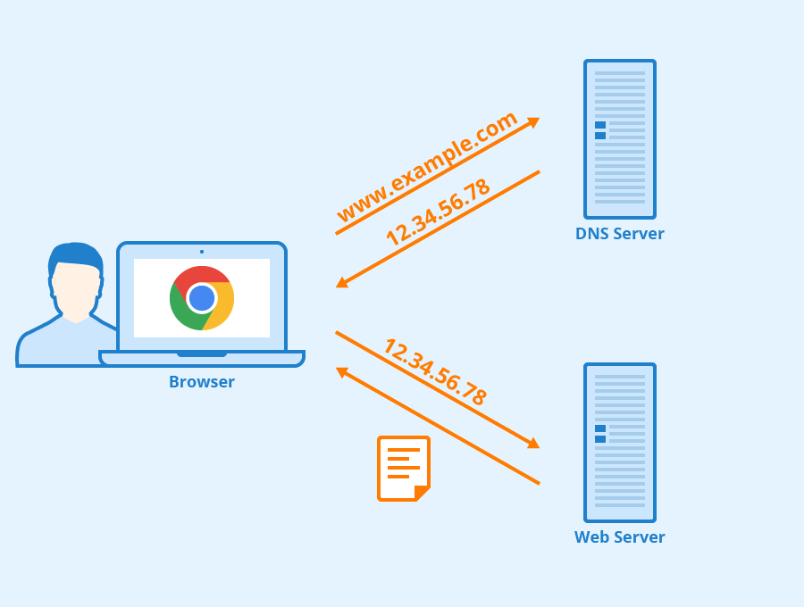
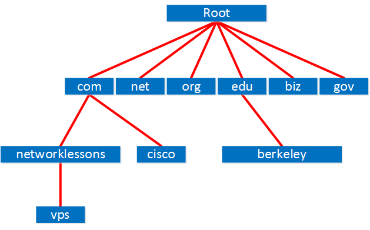

# Application Layer

## 1. Role of Application Layer

The role of the Application Layer is to provide network services directly to user applications.

> **Client**: Requests services or resources.

> **Server**: Provides services or resources.

Different applications use different protocols depending on the type of service they require.

Many application-layer protocols are also commonly associated with specific port numbers.

### Protocols

| Protocol | Objective | Port |
|---|---|---|
| HTTP | Web communication | 80 |
| DNS | Domain name resolution | 53 |
| FTP | FTP data transfer and control | 20, 21 |
| SMTP | Email transmission | 25 |
| POP3 | Email retrieval | 110 |

## 2. HTTP Protocol

> **Request**: A message sent by a client to request a resource or action from a server.

> **Response**: A message sent by a server in response to a client's request.

If a client requests a webpage from a web server, the server responds with the requested resource.

This communication can be performed using the HTTP protocol.

> **HTTP (HyperText Transfer Protocol)**: An application-layer protocol used for web communication.

> **Parsing**: The process of analysing structured data according to a specific format or syntax.

HTTP messages have a defined structure, so received HTTP data can be parsed according to that structure.

### Structure of HTTP

At the beginning of an HTTP message, there is a **start line**.

The start line indicates the type of HTTP message and contains different information depending on whether it is a request or a response.

### Request

In an HTTP request, the start line contains:

- HTTP method
- Request path
- HTTP version

#### HTTP Method

An HTTP method indicates the action that the client wants to perform on a resource.

**Types of Method**

- GET: retrieving data from a server.
- POST: submitting data to a server.
- PUT: creating or replacing a resource.
- PATCH: partially modifying a resource.
- DELETE: deleting a resource.

#### Path

The path identifies the resource requested from the server.

Some default files, such as `index.html`, may be automatically served without being explicitly written in the URL.

#### HTTP Version

The HTTP version indicates which version of the HTTP protocol is being used.

HTTP/1.1 improved connection management compared with HTTP/1.0 and commonly supports persistent connections, allowing multiple requests and responses to use the same TCP connection.

This behaviour is commonly called **Keep-Alive**.

HTTP/2 introduces a binary framing layer and allows multiple request and response streams to be transmitted efficiently over a single connection.

HTTP/1.1 and HTTP/2 are both widely used.

### Response

The start line in an HTTP response includes:

- HTTP version
- Status code
- Reason phrase

#### Response Message

| Status Code | Meaning | Description |
|---|---|---|
| 1xx | Informational | The request has been received and processing is continuing |
| 2xx | Success | The request was successfully processed |
| 3xx | Redirection | Further action is required to access the requested resource |
| 4xx | Client-Side Error | The request cannot be completed because of a client-side issue |
| 5xx | Server-Side Error | The server failed to complete a valid request |

### Header

HTTP headers contain additional information about the request, response, client, server, or transmitted content.

> **Domain Name**: A human-readable name used to identify an Internet resource, which can be resolved to an IP address through DNS.

Examples of HTTP headers include:

- `Host`: Identifies the target host or domain name.
- `Connection`: Provides connection-management information.
- `Accept-Language`: Indicates the languages preferred by the client.

The main content of an HTTP message is commonly carried in the **body**.

## 3. DNS Server & DHCP Server

### DNS Server

Network devices use IP addresses for communication.

Theoretically, users could enter IP addresses directly into a web browser to access servers.

However, IP addresses are difficult to remember and may also change.

To solve this problem, we use **domain names**.

**Example**

- Domain: `google.com`
- IP address: Resolved dynamically through DNS

The mapping between domain names and IP addresses is provided through the DNS system.

> **DNS (Domain Name System) Server**: A server that helps resolve domain names into IP addresses and provides other DNS records.

### Process of Using DNS Server

1. The user enters a domain name, such as `www.google.com`, into a web browser.
2. The device sends a DNS query to its configured DNS resolver.
3. The resolver returns the corresponding IP address if it already knows the answer, or queries other DNS servers to find it.
4. The web browser uses the returned IP address to communicate with the web server.
5. The web server responds to the client's request.

### DNS Hierarchy

If the DNS resolver does not already know the requested record, it may query other DNS servers.

DNS uses a hierarchical structure.

A simplified lookup can involve:

1. Root DNS server
2. TLD (Top-Level Domain) DNS server
3. Authoritative DNS server for the requested domain

The authoritative server provides the DNS record associated with the requested domain.

### DHCP Server

When network devices communicate using IP networks, they need network configuration such as an IP address.

Managing these settings manually for many devices is inefficient, so DHCP can be used.

> **DHCP (Dynamic Host Configuration Protocol) Server**: A server that automatically provides network configuration to clients, such as IP addresses, subnet masks, default gateways, and DNS server addresses.

### Process of Allocation

The DHCP allocation process commonly follows **DORA**:

1. **DHCP Discover**: The client broadcasts a message to find available DHCP servers.
2. **DHCP Offer**: A DHCP server offers an available IP address and configuration.
3. **DHCP Request**: The client requests the offered configuration.
4. **DHCP Acknowledgement (ACK)**: The DHCP server confirms the lease and assigns the configuration to the client.

## 4. SMTP and POP3

When transmitting emails, SMTP is commonly used for sending mail, while protocols such as POP3 or IMAP can be used by recipients to retrieve mail from a mail server.

[photo instruction]

### Communication between a mail server and a sender.

[photo instruction]

As shown in the picture, the sender's email client sends the required email information to its mail server using SMTP.

### Communication between mail servers

[photo instruction]

The sender-side mail server can transmit the email to the receiver-side mail server using SMTP.

TCP port `25` is commonly used for SMTP communication between mail servers.

The receiving mail server then stores the email in the recipient's mailbox.

### Communication between a receiver and a mail server

[photo instruction]

The receiver can connect to the mail server using POP3 and retrieve stored email messages.

POP3 commonly downloads messages from the server to the client. Depending on the client configuration, messages may be deleted from the server after they are downloaded.

If we want emails to remain synchronised between the server and multiple devices, we can use **IMAP (Internet Message Access Protocol)**.

## 5. Load Balancer in the Application Layer

An Application Layer load balancer can make forwarding decisions using information contained in application-layer traffic.

In addition to distributing traffic across multiple backend servers, it can route requests based on information such as:

- URL or URI
- HTTP headers
- Cookies
- Hostnames
- Request paths

Simply, an Application Layer load balancer can distribute traffic based on the content or service being requested.  